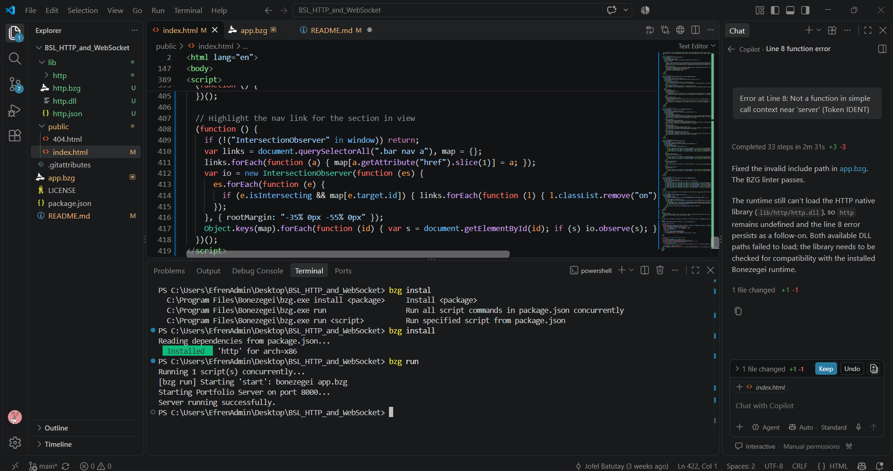
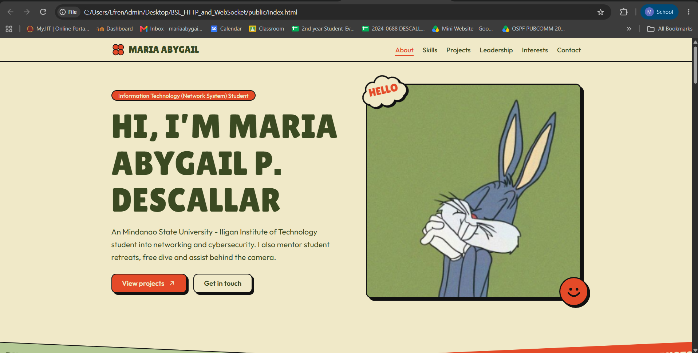

# Personal Portfolio Project

## 1. Project Description
A personal portfolio web application built using the Bonezegei (BSL) environment and HTML/CSS. It serves as a digital showcase for my background, technical skills, and projects.

## 2. Setup & Execution Steps
Follow these steps to run the server:
1. Open your terminal in the project root directory.
2. Install the required dependencies:

``` bash
# install all dependencies
bzg install

3. Start the web server:

# run the app
bzg run
```

## 3. Execution Verification

### Terminal Output


### Browser Landing Page


